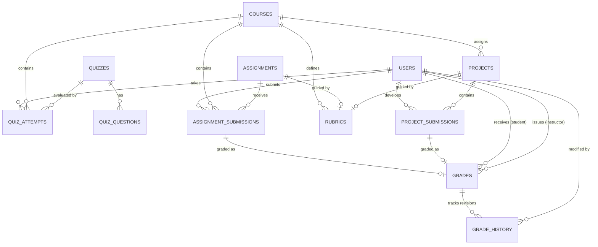

# Prompt Care Academy — Persistent Academic Workflows & Evaluation Engine

## 1. Executive Summary

Prompt Care Academy has completed the implementation and verification of persistent academic workflows on PostgreSQL with Drizzle ORM. Student academic artifacts—including quiz attempts, assignment submissions, rubric evaluations, instructor feedback, grade history revisions, and capstone project submissions—are now persistently stored in PostgreSQL and survive page refreshes, session changes, and re-authentication.

### Key Milestones Achieved
- **PostgreSQL-Native Academic Schema**: Implemented 7 new relational tables in [`db/schema/academic.ts`](file:///c:/Users/USER/Desktop/v0-lms-with-mongo-db/db/schema/academic.ts) with foreign keys, compound indexes, and native PostgreSQL UUID primary keys.
- **Trusted Server-Side Quiz Scoring**: Students cannot view answer keys or explanations during active attempts; scoring is computed authoritatively on the server by cross-referencing official PostgreSQL records.
- **Assignment Submission Pipeline**: Supports multi-attempt submissions with text content, artifact URLs (e.g. GitHub repositories, Figma, Google Drive), and automated attempt numbering.
- **Rubrics & Criteria Engine**: Multi-dimensional rubrics with custom criteria, weights, and scoring items linked to assignments and projects.
- **Auditable Grade History**: Multi-version grade revision tracking in `grade_history`, capturing previous/new scores, feedback, instructor IDs, timestamps, and modification reasons.
- **Capstone Project Lifecycle**: Full submission workflow supporting repository links, demo URLs, artifact metadata, and instructor evaluations.
- **Interactive UI Integration**: Deployed [`QuizRunner`](file:///c:/Users/USER/Desktop/v0-lms-with-mongo-db/components/academic/QuizRunner.tsx), [`AssignmentSubmissionPanel`](file:///c:/Users/USER/Desktop/v0-lms-with-mongo-db/components/academic/AssignmentSubmissionPanel.tsx), and [`CapstoneProjectPanel`](file:///c:/Users/USER/Desktop/v0-lms-with-mongo-db/components/academic/CapstoneProjectPanel.tsx) into the student course learn page ([`app/dashboard/courses/[courseId]/learn/page.tsx`](file:///c:/Users/USER/Desktop/v0-lms-with-mongo-db/app/dashboard/courses/%5BcourseId%5D/learn/page.tsx)).
- **Zero Legacy MongoDB Dependency**: Complete isolation from MongoDB. All academic workflows operate strictly against PostgreSQL.

---

## 2. PostgreSQL Schema Architecture

The academic data model is defined in [`db/schema/academic.ts`](file:///c:/Users/USER/Desktop/v0-lms-with-mongo-db/db/schema/academic.ts) and applied via Drizzle migration [`0003_equal_molly_hayes.sql`](file:///c:/Users/USER/Desktop/v0-lms-with-mongo-db/db/migrations/0003_equal_molly_hayes.sql).

### Entity Relationship Model



### Table Specifications

| Table Name | Primary Key | Foreign Keys | Key Indexes | Description |
| :--- | :--- | :--- | :--- | :--- |
| `quiz_attempts` | `id` (UUID) | `quiz_id` -> `quizzes.id`<br>`course_id` -> `courses.id`<br>`user_id` -> `users.id` | `idx_quiz_attempts_user_quiz`<br>`idx_quiz_attempts_course` | Tracks in-progress and completed quiz attempts, calculated scores, and per-question answer records. |
| `assignment_submissions` | `id` (UUID) | `course_id` -> `courses.id`<br>`user_id` -> `users.id` | `idx_assignment_submissions_user_assignment`<br>`idx_assignment_submissions_course` | Stores submission text, artifact URLs, auto-incrementing attempt numbers, and workflow states. |
| `rubrics` | `id` (UUID) | `course_id` -> `courses.id` | `idx_rubrics_course` | Configures structured grading criteria with point allocations and targets (assignment or project). |
| `grades` | `id` (UUID) | `course_id` -> `courses.id`<br>`student_id` -> `users.id`<br>`instructor_id` -> `users.id` | `uniq_grades_submission`<br>`idx_grades_student`<br>`idx_grades_course` | Published grades with total score, max points, rubric score breakdown, and written instructor feedback. |
| `grade_history` | `id` (UUID) | `grade_id` -> `grades.id`<br>`changedBy` -> `users.id` | `idx_grade_history_grade` | Immutable audit log of all grade adjustments, recording previous score, new score, and justification. |
| `projects` | `id` (UUID) | `course_id` -> `courses.id` | `idx_projects_course` | Capstone project requirements, instructions, max scores, and due dates. |
| `project_submissions` | `id` (UUID) | `project_id` -> `projects.id`<br>`course_id` -> `courses.id`<br>`user_id` -> `users.id` | `uniq_project_submissions_user_project`<br>`idx_project_submissions_course` | Student capstone project deliverables (code repo URL, live demo URL, artifacts metadata). |

---

## 3. Quiz Workflow & Anti-Cheat Engine

### Authoritative Server-Side Scoring
Quiz answers are never scored client-side. The client submits only user selections:
```json
{
  "answers": [
    { "questionId": "d0e1...", "selectedOption": 1 },
    { "questionId": "f2a3...", "selectedOption": 2 }
  ]
}
```

1. **Attempt Validation**: The server verifies that the attempt exists, belongs to the authenticated user, and is currently in status `"in_progress"`. Cross-user submissions return HTTP 403 Forbidden.
2. **Authoritative Key Retrieval**: The server queries `quiz_questions` from PostgreSQL for the official `correctAnswer` and points.
3. **Scoring Calculation**:
   - Matches each submitted answer to the corresponding question.
   - Computes correctness (`isCorrect: boolean`) and points.
   - Aggregates score percentage: $\text{score} = \text{round}\left(\frac{\text{correctCount}}{\text{totalQuestions}} \times 100\right)$.
   - Evaluates pass mark: $\text{passed} = \text{score} \ge \text{passingScore}$.
4. **State Transition**: Atomically marks the attempt as `"completed"`, records `completedAt`, and saves calculated answers with breakdown.

### Anti-Cheat Question Masking
When students request quiz questions via `/api/courses/[id]/quizzes/[quizId]/attempt?mode=questions`, the server executes `getQuizForStudent(quizId)`:
- Returns: `id`, `title`, `passingScore`, `timeLimit`, and questions with `options`.
- **Masks and omits**: `correctAnswer` and `explanation`.
- Prevents inspection of source data or browser network payload inspection to discover answers in advance. Explanations and answer evaluations are only revealed upon attempt completion.

---

## 4. Assignment Submission Pipeline

Students submit assignments directly through the LMS interface:
- **Multiple Attempts**: Each submission queries previous attempts by `(userId, assignmentId)` and sets `attemptNumber = count + 1`.
- **Dual Deliverable Types**: Accommodates both direct written responses (e.g. system design reflections, code snippets) and external artifact links (GitHub repositories, Figma design files, cloud documents).
- **Status Lifecycle**: `submitted` $\rightarrow$ `graded` $\rightarrow$ (optionally `resubmission_requested`).

API Endpoint: `POST /api/courses/[id]/assignments/[assignmentId]/submissions`
```typescript
const submission = await academicDb.createAssignmentSubmission({
  assignmentId,
  courseId,
  lessonId,
  userId: user.id,
  content: body.content,
  artifactUrls: body.artifactUrls,
})
```

---

## 5. Rubrics & Criteria Engine

Instructors and course administrators can define structured evaluation criteria:
- **Criteria Modeling**: Each criterion contains an `id`, `title`, `description`, and `maxPoints`.
- **Target Association**: Rubrics can target a specific `assignmentId` or `projectId` within a course.
- **Evaluation Alignment**: When grading, instructors score each criterion individually, providing itemized comments and points that roll up to the total score.

API Endpoint: `POST /api/courses/[id]/rubrics`
```typescript
const rubric = await academicDb.createRubric({
  courseId,
  assignmentId,
  title: "Full-Stack Web App Rubric",
  criteria: [
    { id: "crit_backend", title: "API & Database Design", maxPoints: 40 },
    { id: "crit_frontend", title: "User Experience & UI", maxPoints: 40 },
    { id: "crit_testing", title: "Automated Tests", maxPoints: 20 },
  ],
  totalMaxPoints: 100,
})
```

---

## 6. Instructor Grading & Immutable Grade History

### Atomic Grade Transactions
Grading is executed via `academicDb.gradeSubmission()`:
- **First Grade**: Inserts a new record into `grades` with `status: 'published'` and updates the submission status in `assignment_submissions` or `project_submissions` to `"graded"` / `"approved"`.
- **Grade Revision**: When an instructor revises an existing grade, an immutable history entry is automatically inserted into `grade_history` before updating the primary `grades` record:
  - `gradeId`: Target grade reference.
  - `changedBy`: ID of the authenticated instructor making the modification.
  - `previousScore` / `newScore`: Numeric score before and after change.
  - `previousFeedback` / `newFeedback`: Written remarks before and after change.
  - `reason`: Justification provided by the instructor for auditability.
  - `createdAt`: Timestamp of modification.

```typescript
// Automatic audit capture on grade revision
await this.db().insert(schema.gradeHistory).values({
  id: randomUUID(),
  gradeId: existing.id,
  changedBy: data.instructorId,
  previousScore: existing.score,
  newScore: data.score,
  previousFeedback: existing.feedback,
  newFeedback: data.feedback,
  reason: data.reason ?? "Grade updated by instructor",
  createdAt: now,
})
```

---

## 7. Capstone Projects & Evaluations

Capstone projects provide comprehensive hands-on evaluation for technology academy students:
- **Project Definitions**: Instructors create projects with detailed instructions, deliverables, criteria, and submission deadlines.
- **Student Submissions**: Students submit repository links (e.g. GitHub/GitLab), live application demo links, and artifact metadata.
- **Idempotent Updates**: Subsequent submissions by the same student update the project submission record rather than creating orphan duplicates, while preserving history through grading records.
- **Status Progression**: Transitions from `"submitted"` to `"under_review"` to `"approved"` upon instructor grade publication.

---

## 8. Frontend Student Learning Experience

The course learning view ([`app/dashboard/courses/[courseId]/learn/page.tsx`](file:///c:/Users/USER/Desktop/v0-lms-with-mongo-db/app/dashboard/courses/%5BcourseId%5D/learn/page.tsx)) was updated to integrate the academic workflow components:

1. **[`QuizRunner.tsx`](file:///c:/Users/USER/Desktop/v0-lms-with-mongo-db/components/academic/QuizRunner.tsx)**:
   - Detects quiz lessons (`currentLesson.type === 'quiz'` or `content.quizId`).
   - Fetches attempt history and masked questions.
   - Provides clean interactive question navigation with accessible radio selection.
   - Renders live progress and score cards with question breakdown upon completion.
   - Automatically invokes `markLessonComplete()` to advance course progress upon passing.
2. **[`AssignmentSubmissionPanel.tsx`](file:///c:/Users/USER/Desktop/v0-lms-with-mongo-db/components/academic/AssignmentSubmissionPanel.tsx)**:
   - Detects assignment lessons (`currentLesson.type === 'assignment'` or `content.assignmentId`).
   - Renders written submission textarea and dynamic artifact URL input list.
   - Displays real-time submission history with attempt numbers.
   - Shows published instructor scores, feedback, and rubric criteria breakdown.
3. **[`CapstoneProjectPanel.tsx`](file:///c:/Users/USER/Desktop/v0-lms-with-mongo-db/components/academic/CapstoneProjectPanel.tsx)**:
   - Accessible via the "Course Capstone Project" toggle in the course navigation sidebar.
   - Displays project instructions, repository link inputs, and live deployment verification.
   - Presents final capstone evaluation score and comments.

---

## 9. Verification Test Results & Evidence

All quality gates, unit tests, integration tests, security tests, staging verification, and production builds were executed and verified against PostgreSQL:

### Test Suite Execution Summary

| Test Suite | Command | Result | Duration | Scope |
| :--- | :--- | :--- | :--- | :--- |
| **Academic Workflows & API** | `npm run test:academic` | **16 / 16 PASSED** | ~4.3s | Quiz authoring, anti-cheat masking, server scoring, attempt lifecycle, assignment submissions, rubrics, grade revisions, grade history audit trail, capstone projects, and API endpoints. |
| **Staging Runtime Verification** | `npm run test:staging-verify` | **6 / 6 PASSED** | ~3.2s | End-to-end PostgreSQL routing, zero MongoDB execution, administrator bootstrap idempotency, audit logs. |
| **Payment Verification** | `npm run test:payments` | **6 / 6 PASSED** | ~0.8s | Currency matching, Paystack status, case-insensitive email match, manual review states. |
| **Admin Bootstrap Security** | `npx tsx --test tests/security/admin-bootstrap-security.test.ts` | **8 / 8 PASSED** | ~47.4s | Role escalation prevention, bcrypt hash verification, concurrent login safety. |
| **Auth Security & Permissions** | `npx tsx --test tests/security/auth-security.test.ts` | **6 / 6 PASSED** | ~2.3s | RBAC enforcement, route guards, ownership checks. |
| **TypeScript Type Checking** | `npx tsc --noEmit` | **0 ERRORS** | ~40s | Full strict TypeScript compiler validation across all modules. |
| **ESLint Quality Gate** | `npm run lint` | **0 ERRORS** | ~2.5s | Strict linting compliance. |
| **Next.js Production Build** | `npm run build` | **0 ERRORS** | ~78s | All 89 App Router routes compiled cleanly with Turbopack. |

---

## 10. Operational Guidelines & Maintenance

### Database Integrity Guarantees
1. **Isolated Testing**: All automated tests run against `learnhub_test` (`postgresql://...:5432/learnhub_test`) and clean up their test artifacts upon completion.
2. **Foreign Key Integrity**: Academic tables utilize `ON DELETE RESTRICT` or foreign keys cascading to courses and users, ensuring no orphan submissions exist if a student or course is referenced.
3. **Primary Key Standard**: All new academic records use native UUIDs (`crypto.randomUUID()`), completely avoiding legacy MongoDB 24-character hexadecimal IDs.
4. **Environment Isolation**: Production environments require explicit `DATABASE_BACKEND=postgres` and `DATABASE_URL`. The application fails closed if database configuration is ambiguous.
