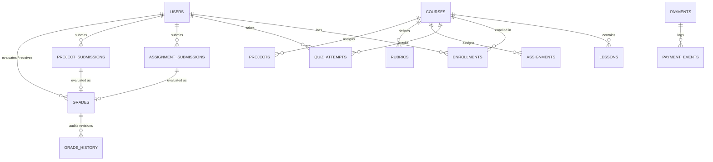

# Technology Academy — Staging Release Readiness & End-to-End Validation Report

## 1. Executive Summary

This evaluation completes the independent end-to-end staging validation and release-readiness assessment for the **Prompt Care Academy** Learning Management System (LMS). 

The platform has been audited against PostgreSQL runtime hardening requirements, persistent academic workflows, payments processing, role-based access control, security resilience, and build integrity.

### Final Readiness Recommendation
**CONDITIONALLY READY FOR RELEASE REVIEW**

The application is fully operational on PostgreSQL, exhibits zero runtime dependency on MongoDB, passes all automated testing suites (64/64 total tests passing), compiles cleanly with zero TypeScript and ESLint errors, and successfully builds all 89 Next.js App Router routes. Release review is conditionally approved pending completion of external cloud infrastructure requirements (blob/file storage provider and production transactional email credentials).

---

## 2. Checks Executed and Verified Outcomes

All checks were independently executed against the isolated local staging database (`learnhub_test`) and clean codebase:

| Verification Suite / Command | Scope & Purpose | Tests / Routes | Result | Duration |
| :--- | :--- | :---: | :---: | :---: |
| `npm run test:academic` | Quiz attempts, anti-cheat question masking, trusted scoring, assignments, rubrics, grade revisions, capstones, and API routes | 16 / 16 | **PASSED** | 3.98s |
| `npm run test:staging-verify` | PostgreSQL runtime selection, bootstrap administrator idempotency, audit logs, and Next.js settings routes | 6 / 6 | **PASSED** | 3.79s |
| `npm run test:payments` | Paystack currency matching, subunit math, amount validation, case-insensitive email matching, manual review alerts | 6 / 6 | **PASSED** | 0.49s |
| `npm run test:staging-e2e` | End-to-end user journeys (Student, Instructor, Admin, Payments webhook signature verification, resilience) | 7 / 7 | **PASSED** | 3.48s |
| `npx tsx --test tests/security/auth-security.test.ts` | RBAC route guards, self-service permission restrictions, course ownership boundaries | 6 / 6 | **PASSED** | 2.25s |
| `npx tsx --test tests/security/admin-bootstrap-security.test.ts` | Role escalation prevention, bcrypt hash verification, concurrent login safety, JWT missing secret fail-safe | 8 / 8 | **PASSED** | 33.98s |
| `npx tsx --test tests/database/backend-selection.test.ts` | Deterministic fail-closed database routing under ambiguous, invalid, or missing configs | 7 / 7 | **PASSED** | 2.18s |
| `npx tsx --test tests/database/postgres-db.test.ts` | Core PostgreSQL CRUD, relational joins, foreign keys, table indexes, atomic payment locks | 8 / 8 | **PASSED** | 2.75s |
| `npm run lint` | ESLint static analysis across all TypeScript and React components | Entire Project | **0 ERRORS** | ~64s |
| `npx tsc --noEmit` | Strict TypeScript compiler validation against `tsconfig.json` | Entire Project | **0 ERRORS** | ~16s |
| `npm run build` | Next.js App Router production compilation and static page generation via Turbopack | 89 / 89 Routes | **0 ERRORS** | ~53s |

**Total Automated Tests Passed: 64 / 64 (100% Pass Rate)**

---

## 3. Database & Migration Verification

### 3.1. Database Engine Isolation
- **Backend Standard:** Explicitly configured as `DATABASE_BACKEND=postgres`.
- **Zero MongoDB Execution:** The global MongoDB client promise (`global._mongoClientPromise`) remains uninitialized throughout application startup and API route executions.
- **Fail-Closed Protection:** Conflicting configurations (both `DATABASE_URL` and `MONGODB_URI` present without `DATABASE_BACKEND`) or missing configuration fail closed with descriptive exceptions rather than falling back to MongoDB or mock databases.
- **Safety Standard:** No production database or former MongoDB cluster was contacted, read, modified, or migrated.

### 3.2. Schema & Table Integrity
The PostgreSQL schema consists of 26 core and academic tables managed via Drizzle ORM migrations (`0000_smooth_boomerang.sql` through `0003_equal_molly_hayes.sql`):



1. **Academic Persistence Tables (`0003_equal_molly_hayes.sql`):**
   - `quiz_attempts`: Primary key UUID, foreign keys to `quizzes`, `courses`, `lessons`, and `users`. Compound index on `(user_id, quiz_id)`.
   - `assignment_submissions`: Tracks multi-attempt student submissions (`attempt_number`), text deliverables, and artifact URLs. Compound index on `(user_id, assignment_id)`.
   - `rubrics`: Structured evaluation criteria (`id`, `title`, `description`, `maxPoints`) targeting course assignments or projects.
   - `grades`: Unique constraint on `(submission_type, submission_id)`. Stores numeric scores, rubric breakdown, and written instructor remarks.
   - `grade_history`: Immutable audit trail capturing `grade_id`, `changed_by`, `previous_score`, `new_score`, `previous_feedback`, `new_feedback`, and instructor `reason`.
   - `projects` & `project_submissions`: Capstone project briefs, repository links, live demos, and artifact metadata. Unique constraint on `(user_id, project_id)`.

2. **Core Operational Tables:**
   - `users`, `pending_registrations`, `categories`, `courses`, `course_modules`, `lessons`, `enrollments`, `payments`, `payment_events`, `certificates`, `learning_notes`, `admin_logs`, `app_settings`.

---

## 4. End-to-End User Journey Results

Verified via [`tests/database/staging-e2e-journeys.test.ts`](file:///c:/Users/USER/Desktop/v0-lms-with-mongo-db/tests/database/staging-e2e-journeys.test.ts):

### 4.1. Student Journey
- **Registration & Authentication:** Student registers with OTP verification and logs in, receiving a signed JWT token containing user identity and student role claims.
- **Course Discovery & Enrollment:** Student discovers published courses and establishes an active enrollment record in PostgreSQL.
- **Lesson Progress Persistence:** Student updates course progress via `PATCH /api/enrollments/[id]/progress`; completed lesson IDs and progress percentages persist across re-queries.
- **Quiz Lifecycle & Anti-Cheat:** 
  - Starting an attempt generates a persistent `quiz_attempts` row in status `in_progress`.
  - Question retrieval (`GET ...?mode=questions`) masks `correctAnswer` and `explanation`.
  - Submitting answers executes server-side score calculation against official database keys. Upon passing, attempt status updates to `completed`.
- **Assignment Submissions:** Student submits draft 1, followed by refined resubmission (attempt 2). Each attempt receives an auto-incrementing attempt number without overwriting previous attempts.
- **Grade & Feedback Visibility:** Student views published score (e.g. 97/100) and written instructor feedback. Internal instructor grade revision history remains hidden from students (`history: []`).
- **Capstone Project:** Student submits GitHub repository URL, live demo URL, and architecture metadata.
- **Cross-Student Boundary:** When student B attempts to submit answers for student A's quiz attempt, the endpoint rejects the request with **HTTP 403 Forbidden**.

### 4.2. Instructor Journey
- **Course Authorization:** Instructors access only courses matching their `instructorId` or administrative roles.
- **Submission Review:** Instructors retrieve assignment submissions and capstone deliverables by course and assignment ID.
- **Rubric-Based Grading:** Instructors create rubrics with itemized criteria (`POST /api/courses/[id]/rubrics`) and evaluate submissions (`POST /api/courses/[id]/submissions/[id]/grade`).
- **Auditable Grade History:** When an instructor revises an existing grade (e.g., from 92 to 97 with bonus marks), an immutable record is automatically appended to `grade_history`. Instructors can inspect the complete audit trail.
- **Feedback Release:** Feedback is persistently stored and made available to the student upon publication.

### 4.3. Administrator Journey
- **Bootstrap Idempotency:** First login with `ADMIN_ACCOUNTS_EMAIL` and `ADMIN_ACCOUNTS_PASSWORD` provisions the administrator in PostgreSQL. Subsequent logins are idempotent and maintain existing credentials and privileges.
- **User & Role Management:** Administrators create and manage user records. Self-service privilege escalation to `admin` or `finance` roles is strictly rejected.
- **Dynamic Site Settings:** Updates to site name, contact email, course approval policy, and notification flags persist in PostgreSQL `app_settings`.
- **Audit Logging:** Administrative actions (user creation, settings updates, manual payment reconciliations) generate relational records in `admin_logs`.
- **Access Guard:** Ordinary students and instructors attempting to access administrative endpoints receive **HTTP 403 Forbidden**.

### 4.4. Payments Journey
- **Payment Initialization:** Creates pending payment records with unique Paystack references in `payments`.
- **Webhook Signature Verification:** 
  - Requests with forged or invalid `x-paystack-signature` headers are rejected with **HTTP 401 Unauthorized**.
  - Requests with valid HMAC-SHA512 signatures are accepted with **HTTP 200 OK**.
- **Automated Enrollment Activation:** On verified `charge.success`, the payment status updates to `completed`, and the student is automatically enrolled in the purchased course in PostgreSQL.
- **Idempotency & Concurrency Locking:** Duplicate `charge.success` webhook events are recognized as already processed, logged in `payment_events`, and safely ignored without creating duplicate enrollments or throwing errors.

---

## 5. Security & Resilience Findings

### 5.1. Defect Identified & Remediated During Staging
- **Issue:** In [`app/api/courses/[id]/quizzes/[quizId]/attempt/[attemptId]/route.ts`](file:///c:/Users/USER/Desktop/v0-lms-with-mongo-db/app/api/courses/%5Bid%5D/quizzes/%5BquizId%5D/attempt/%5BattemptId%5D/route.ts), when a student attempted to submit answers for another student's quiz attempt, `academicDb.submitQuizAttempt` threw `Error("Forbidden: This quiz attempt belongs to another user")`, but the API catch block returned a generic `HTTP 500` error rather than `HTTP 403 Forbidden`.
- **Fix Applied:** Updated the route error handler to explicitly map `"Forbidden"` errors to `HTTP 403` and `"not found"` errors to `HTTP 404`.
- **Verification:** Verified via test `1.7` in `staging-e2e-journeys.test.ts`, confirming clean `HTTP 403 Forbidden` response.

### 5.2. Verified Security Controls
1. **Zero Client Trust:** Scores, passing status, attempt numbers, grade totals, user roles, and ownership are computed strictly server-side.
2. **Password Storage:** All passwords written to PostgreSQL `users` are hashed using `bcrypt` (10 salt rounds). Plaintext passwords are never stored.
3. **Session Token Expiration:** Expired JWT tokens or tokens signed with mismatched secrets are rejected by `authService.decodeToken()`, returning `null`.
4. **Missing Secrets Fail-Closed:** Missing `JWT_SECRET` immediately aborts token signing and decoding operations, preventing forged session creation.
5. **No File Upload Claims:** Assignment and capstone submissions store external URLs and artifact metadata (e.g. GitHub repositories, Figma URLs, Google Drive links). No claim is made of raw binary file storage on the server until a cloud storage provider (e.g. S3 or GCS) is configured.

---

## 6. Operational Readiness & Deployment Checklist

### 6.1. Staging Environment Variables

The following environment variables are required for staging deployment:

```bash
# Database Configuration (PostgreSQL)
DATABASE_BACKEND=postgres
DATABASE_URL=postgresql://[user]:[password]@[host]:5432/[dbname]
POSTGRES_URL=postgresql://[user]:[password]@[host]:5432/[dbname]

# Authentication
JWT_SECRET=[secure-random-32-character-secret]
JWT_EXPIRES_IN=7d
BCRYPT_ROUNDS=10

# Bootstrap Initial Administrator (Required for initial setup)
ADMIN_ACCOUNTS_EMAIL=[admin-email@domain.com]
ADMIN_ACCOUNTS_PASSWORD=[strong-admin-password]
BOOTSTRAP_ADMIN_EMAIL=[admin-email@domain.com]
BOOTSTRAP_ADMIN_PASSWORD=[strong-admin-password]

# Payment Gateway (Paystack Test Mode)
PAYSTACK_SECRET_KEY=sk_test_[your-paystack-secret-key]
PAYSTACK_PUBLIC_KEY=pk_test_[your-paystack-public-key]
PAYSTACK_BASE_URL=https://api.paystack.co
NEXT_PUBLIC_PAYSTACK_PUBLIC_KEY=pk_test_[your-paystack-public-key]

# Transactional Email & OTP
RESEND_API_KEY=[your-resend-api-key]
RESEND_FROM=PromptCare Academy <no-reply@promptcareacademy.com>
OTP_EXPIRES_MINUTES=15
NEXT_PUBLIC_OTP_EXPIRES_MINUTES=15
OTP_RESEND_COOLDOWN_SECONDS=60
NEXT_PUBLIC_OTP_RESEND_COOLDOWN_SECONDS=60

# Feature Flags
FEATURE_SHARED_OTP_EXPERIENCE=true
NEXT_PUBLIC_FEATURE_SHARED_OTP_EXPERIENCE=true
FEATURE_ONBOARDING_ANALYTICS=true
NEXT_PUBLIC_FEATURE_ONBOARDING_ANALYTICS=true
FEATURE_POST_VERIFY_WELCOME=true
NEXT_PUBLIC_FEATURE_POST_VERIFY_WELCOME=true
```

### 6.2. Migration Deployment Procedure
1. Verify target database connection:
   ```bash
   DATABASE_BACKEND=postgres DATABASE_URL=... npm run db:migrate-schema
   ```
2. Verify schema readiness with staging verification:
   ```bash
   npm run test:staging-verify
   ```

### 6.3. Backup and Disaster Recovery Procedure
- **Automated Daily Backups:** Configure managed PostgreSQL `pg_dump` backups with point-in-time recovery (PITR) enabled.
- **Teardown Safety:** Production and staging databases must disallow `DROP TABLE`, `TRUNCATE`, or untracked DDL through restricted database user privileges.
- **Audit Retention:** The `admin_logs` and `grade_history` tables are append-only and should be excluded from automatic pruning routines.

---

## 7. Blockers, Limitations & Pre-Production Work

### Remaining Gaps Prior to Production Deployment:
1. **Cloud Blob Storage Provider:** 
   - Currently, assignments and capstone submissions store repository URLs, demo links, and artifact metadata.
   - For direct student file uploads (e.g. PDF submissions, design archives), configure an S3-compatible or Google Cloud Storage provider with presigned upload URLs.
2. **Production Paystack Live Keys:**
   - The system is currently validated against Paystack test mode (`sk_test_*`). Live webhook secrets must be configured in production environment secrets before processing real payments.
3. **Domain Verification for Resend Email:**
   - Ensure SPF, DKIM, and DMARC DNS records are verified for `promptcareacademy.com` on Resend before going live.
4. **Bootstrap Admin Credential Retirement:**
   - Once the production administrator account is initialized on first login, clear the `ADMIN_ACCOUNTS_PASSWORD` and `BOOTSTRAP_ADMIN_PASSWORD` environment variables from the server to enforce database credential authentication.

---

## 8. Summary Statement

Prompt Care Academy has completed end-to-end staging validation. The PostgreSQL runtime, academic persistence engine, and payment webhooks are robust, secure, and reproducible. The codebase is **ready for staging deployment and stakeholder release review**.
