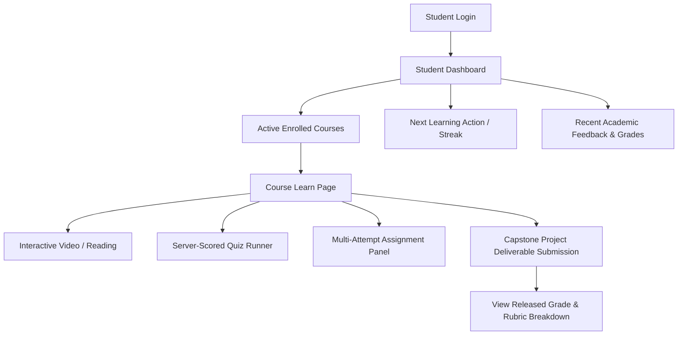
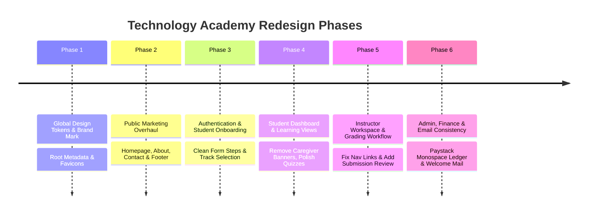

# Technology Academy — UI Audit and Redesign Plan

## 1. Executive Summary

### 1.1. Context and Objective
This audit and redesign plan establishes the architectural and visual roadmap to transform the **Prompt Care Academy** Learning Management System (LMS)—originally conceived as a healthcare and caregiver vocational training platform—into a premier, modern **Technology Academy for practical technology skills**.

The platform provides training in software engineering, frontend and backend development, artificial intelligence, data science, cybersecurity, cloud computing, and product design. The engineering challenge is that while recent backend and persistence initiatives ([`TECH_ACADEMY_POSTGRES_RUNTIME_HARDENING.md`](file:///c:/Users/USER/Desktop/v0-lms-with-mongo-db/TECH_ACADEMY_POSTGRES_RUNTIME_HARDENING.md) and [`TECH_ACADEMY_ACADEMIC_PERSISTENCE.md`](file:///c:/Users/USER/Desktop/v0-lms-with-mongo-db/TECH_ACADEMY_ACADEMIC_PERSISTENCE.md)) have decoupled the application from MongoDB, established deterministic PostgreSQL execution, and created persistent academic evaluation data models (quizzes, assignments, rubrics, multi-version grade revisions, and capstone projects), the user-facing interface remains heavily saturated with healthcare-specific branding, caregiver terminology, clinical imagery, hospital references, and legacy physical training assumptions.

### 1.2. Scope and Non-Negotiable Boundaries
- **Preserve Working Architecture:** The application operates on Next.js 16 App Router, React 19, TypeScript, Tailwind CSS v4, Radix UI primitives, Framer Motion, and Drizzle ORM on PostgreSQL. Working API handlers, authentication guards, payment verification hooks (Paystack), and academic persistence workflows must be retained without disruption.
- **Fail-Closed PostgreSQL Persistence:** As verified in [`TECH_ACADEMY_STAGING_RELEASE_READINESS.md`](file:///c:/Users/USER/Desktop/v0-lms-with-mongo-db/TECH_ACADEMY_STAGING_RELEASE_READINESS.md), the system strictly executes on PostgreSQL. No fallback to MongoDB or mock stores shall be reintroduced, and no schema migrations or destructive database operations may be executed for purely visual adjustments.
- **Evidence-Based Grounding:** Every route, component, file path, and token referenced in this audit corresponds to verified repository files.

---

## 2. Repository Findings & Architecture Inventory

### 2.1. Framework, Runtime & Dependencies
Audited directly from [`package.json`](file:///c:/Users/USER/Desktop/v0-lms-with-mongo-db/package.json):
- **Core Framework:** Next.js `^16.1.6` (App Router, Route Handlers, Turbopack).
- **UI Runtime:** React `19.2.0`, React DOM `19.2.0`, TypeScript `^5` (`strict: true`).
- **Styling Architecture:** Tailwind CSS `^4.1.9` via `@tailwindcss/postcss`, `tw-animate-css` (`1.3.3`), PostCSS `^8.5`.
- **Component Primitives:** Full Radix UI suite (`@radix-ui/react-accordion`, `dialog`, `dropdown-menu`, `popover`, `select`, `tabs`, `toast`, `tooltip`, `progress`, etc.), shadcn/ui "new-york" styling convention.
- **Icons & Motion:** `lucide-react` (`^0.454.0`), `framer-motion` (`12.23.26`).
- **Data Visualization:** `recharts` (`2.15.4`).
- **Form & Validation:** `react-hook-form` (`^7.60.0`), `zod` (`3.25.76`), `@hookform/resolvers` (`^3.10.0`).
- **Client State & Sessions:** `zustand` (`5.0.9`) with local storage persistence (`auth-storage`, `cart-storage`, `preferences-storage`).
- **Database & Persistence:** `pg` (`^8.23.1`), `drizzle-orm` (`^0.45.3`), `drizzle-kit` (`^0.31.11`), PostgreSQL backend default (`db/schema/core.ts`, `db/schema/academic.ts`).
- **Payments & Communication:** Paystack server-side REST with HMAC-SHA512 webhook validation, Resend REST email integration (`lib/email.ts`).

### 2.2. Routing Structure
The application employs Next.js App Router route groups and role-segmented subtrees:

```text
app/
├── (auth)/                               # Public Auth & Onboarding Flow
│   ├── login/                            # Student / standard login
│   ├── register/                         # Student registration entrypoint
│   ├── register-instructor/              # Instructor guided registration
│   ├── register-online/                  # Online learner registration
│   ├── register-onsite/                  # Legacy 21-day caregiver onsite registration
│   ├── verify-otp/                       # Email OTP verification
│   ├── forgot-password/                  # Password recovery initiation
│   └── reset-password/                   # Token-based password reset
├── (public)/                             # Public Marketing & Catalog Subtree
│   ├── page.tsx                          # Public homepage / landing
│   ├── about/                            # About Us, Leadership & Values
│   ├── contact/                          # Admissions & General Inquiry
│   ├── courses/                          # Public Course Catalog & Filter
│   │   └── [id]/                         # Public Course Syllabus & Details
│   ├── campaign/
│   │   └── promptcare-academy/           # Hardcoded Caregiver promotional campaign
│   ├── faq/                              # Frequently Asked Questions
│   ├── privacy/, refund/, terms/         # Legal & compliance terms
│   └── cart/, checkout/                  # Commerce & Paystack integration
├── dashboard/                            # Student Role Console (UserRole: student)
│   ├── page.tsx                          # Student Hub, Next Actions & Stats
│   ├── courses/                          # Enrolled courses list
│   │   └── [courseId]/learn/             # Interactive Learning, Video, Quizzes & Capstones
│   ├── certificates/                     # Issued credentials & verification codes
│   ├── profile/                          # Student settings & learning profile
│   ├── payments/                         # Student payment transaction receipts
│   └── onsite-training/                  # Legacy physical training booking & Paystack upgrade
├── instructor/                           # Instructor Console (UserRole: instructor)
│   ├── page.tsx                          # Instructor Hub & Course Analytics
│   ├── courses/                          # Managed course list
│   ├── create-course/                    # Course authoring & module builder
│   ├── edit-course/[id]/                 # Curriculum editing & lesson management
│   ├── analytics/                        # Enrollment & rating telemetry
│   └── settings/                         # Instructor profile & credentials
├── admin/                                # Administrator Console (UserRole: admin)
│   ├── page.tsx                          # Platform governance hub
│   ├── analytics/                        # Platform-wide metrics
│   ├── courses/                          # Course approvals & status toggles
│   ├── users/                            # User account lifecycle management
│   ├── students/                         # Student roster & milestone logs
│   ├── payments/                         # Payment verification, dispute & locks
│   ├── onsite-training/                  # Legacy onsite cohort management
│   ├── campaign/                         # Landing campaign dynamic config
│   └── settings/                         # Site name, emails & maintenance toggles
├── finance/                              # Finance Console (UserRole: finance)
│   ├── page.tsx                          # Revenue summaries, NGN/USD/GBP breakdowns
│   ├── transactions/                     # Auditable payment ledger
│   ├── reports/                          # Financial exports & reconciliation
│   └── settings/                         # Finance operator credentials
└── api/                                  # Server-side Route Handlers
```

### 2.3. Theme Configuration and Token Baseline
Inspecting [`app/globals.css`](file:///c:/Users/USER/Desktop/v0-lms-with-mongo-db/app/globals.css):
- **Active Fonts:** `--font-inter` ("Inter", "Segoe UI", sans-serif) for body copy; `--font-plus-jakarta` ("Plus Jakarta Sans") for headers `h1`-`h4`.
- **Current Color Tokens (Healthcare Green Dominant):**
  - Light mode: `--primary: #16a34a;` (emerald medical green), `--secondary: #ecfdf3;` (soft mint scrub tint), `--accent: #10b981;`, `--ring: #4ade80;`, `--glow-green: 0 0 0 3px rgba(34, 199, 168, 0.25);`.
  - Dark mode: `--primary: #4ade80;`, `--secondary: #1f2f26;`, `--accent: #34d399;`, `--background: #0e1117;`.
- **Custom Utilities:** `.bg-grain-soft`, `.marquee-track`, `.focus-green-glow`.

---

## 3. Healthcare Content & Visual Artifact Inventory

The following table documents every identified occurrence of the legacy healthcare and caregiver brand across all layers of the codebase:

| Category | File Path | Current Healthcare Content / Behavior | Required Treatment | Classification |
| :--- | :--- | :--- | :--- | :--- |
| **Root Metadata** | [`app/layout.tsx`](file:///c:/Users/USER/Desktop/v0-lms-with-mongo-db/app/layout.tsx) | Title: `"Prompt Care Academy - Premium Online Learning Platform"`. Icons link to `/promptcare-icon.png`. Generator: `"v0.app"`. | Replace with Technology Academy title, metadata descriptions, and modern favicon set. | Displayed Content / Metadata |
| **Brand Identity** | [`components/ui/logo.tsx`](file:///c:/Users/USER/Desktop/v0-lms-with-mongo-db/components/ui/logo.tsx) | Renders `/promptcare-icon.png`, text: `PROMPT CARE ACADEMY`. | Replace with vector SVG Technology Academy logo and brand mark. | Reusable Component |
| **Navigation & Footer** | [`components/layout/public-footer.tsx`](file:///c:/Users/USER/Desktop/v0-lms-with-mongo-db/components/layout/public-footer.tsx) | Copy: *"provides practical caregiver education with expert instruction..."*. Social links: `@Promptcareacademy`. Copyright Prompt Care Academy. | Replace copy with tech focus (software engineering, AI, cloud). Update social links or configure domain-neutral tech handles. | Displayed Content |
| **Public Landing Hero** | [`components/skillup/hero.tsx`](file:///c:/Users/USER/Desktop/v0-lms-with-mongo-db/components/skillup/hero.tsx) | Heading: *"Join thousands of students today to learn and be a caregiver with a difference"*. Body copy: *"equipping the heart and hands of caregivers..."*. Badge: *"Welcome to Prompt Care Academy"*. | Rewrite hero to emphasize coding, system design, data, and engineering careers. Retain animated stats and parallax layout. | Displayed Content |
| **Landing Content** | [`app/(public)/page.tsx`](file:///c:/Users/USER/Desktop/v0-lms-with-mongo-db/app/%28public%29/page.tsx) | `trustItems` include *"Clinical confidence"*. `visualStack` has 4 Pexels clinical images (African male doctor writing notes, doctors reviewing patient in hospital). `journeySlides` are caregiver specific (*"Realistic Clinical Contexts"*, *"Career-Ready Caregivers"*, using `/fundamentals-promptcare.jpeg`, `/clinical-situatuion-promptcare.jpeg`, etc.). | Replace with technology skills marquee (*"Hands-on coding"*, *"Production deployments"*, *"Portfolio reviews"*). Replace clinical images with coding/IDE, terminal, and system architecture visuals. | Displayed Content & Assets |
| **Testimonials** | [`components/testimonials.tsx`](file:///c:/Users/USER/Desktop/v0-lms-with-mongo-db/components/testimonials.tsx) | All 6 testimonials cite healthcare roles: *"Nursing Student"*, *"Healthcare Professional"*, *"Medical Student"*, *"Caregiver"*, *"Nursing Graduate"*, *"Healthcare Administrator"*. | Replace with realistic technology testimonials (e.g. Full-Stack Engineer, Cloud Associate, Data Analyst, UI/UX Designer). | Displayed Content |
| **About Us Page** | [`app/(public)/about/page.tsx`](file:///c:/Users/USER/Desktop/v0-lms-with-mongo-db/app/%28public%29/about/page.tsx) | Heading: *"Training the hands and hearts of modern caregivers"*. Background image is clinical training (`photo-1576091160399...`). Core values feature `Stethoscope` icon (*"Technical Mastery"*), `HeartHandshake` (*"Humanity: train caregivers..."*). Team members listed with medical titles and doctor photos (`ceo-promptcare.jpeg`, `dr-amara-okoye-director.jpeg`). | Redesign for tech academy mission. Reframe values to engineering rigor, problem solving, innovation, accountability, and continuous learning. Replace clinical team with tech instruction leadership. | Displayed Content & Assets |
| **Contact Admissions** | [`app/(public)/contact/page.tsx`](file:///c:/Users/USER/Desktop/v0-lms-with-mongo-db/app/%28public%29/contact/page.tsx) | Hero image: `/contact-medical-care-kit.svg` with alt *"Medical caregiver essentials including clipboard, care cross, and stethoscope"*. Heading: *"Let's plan your next step in healthcare."* | Replace illustration with tech/student support visual. Update copy to *"Launch your technology career"*. | Displayed Content & Assets |
| **Promotional Campaign** | `app/(public)/campaign/promptcare-academy/` | Entire route dedicated to *"Become a world-class certified caregiver in 21 days"*, referencing Prompt Home Health, 150 hours, and scrubs. | Decommission or convert into a Tech Bootcamp immersion campaign. Relocate route or redirect gracefully. | Inactive / Legacy Feature |
| **Caregiver Onsite Config** | [`lib/student-registration.ts`](file:///c:/Users/USER/Desktop/v0-lms-with-mongo-db/lib/student-registration.ts), [`lib/onsite-training-shared.ts`](file:///c:/Users/USER/Desktop/v0-lms-with-mongo-db/lib/onsite-training-shared.ts) | Titles: *"Become a World-Class Certified Caregiver in 21 Days"*. Venues: *"Prompt Care Academy Enugu Campus"*, *"Prompt Care Academy Abuja Centre"*. Benefits: *"Training scrubs"*, *"CPR and First Aid certification"*. | Decouple student registration from physical caregiver assumptions. If physical cohorts exist for tech, rebrand as "In-Person Developer Bootcamp". Otherwise deprecate. | Business Logic & Config |
| **Student Registration Form** | [`components/auth/guided-student-registration-form.tsx`](file:///c:/Users/USER/Desktop/v0-lms-with-mongo-db/components/auth/guided-student-registration-form.tsx) | Legacy hooks referencing `isHealthcareProfessional`, `caregiverInterest`, and physical campus start dates. | Strip healthcare fields; retain clean multi-step onboarding (Name, Email, Password, Track/Interests, Terms). | Component Logic & State |
| **Student Dashboard Banner** | [`components/skillup/onsite-training-banner.tsx`](file:///c:/Users/USER/Desktop/v0-lms-with-mongo-db/components/skillup/onsite-training-banner.tsx) | Persistent banner on student dashboard promoting 21-day caregiver upgrade: *"Train in person, practice hands-on, and graduate with guided career support"*. | Replace with tech career milestone banner (e.g. "Ready for your Capstone Project?" or "Explore Career Mentorship"). | Displayed Component |
| **Student Onsite Dashboard** | `app/dashboard/onsite-training/` | Displays caregiver training venue, dates, and scrubs packaging details with Paystack checkout. | Replace with In-Person Tech Cohort view or gracefully hide if not currently offered. | Page Subtree |
| **Role Dashboard Shell** | [`components/skillup/role-dashboard-shell.tsx`](file:///c:/Users/USER/Desktop/v0-lms-with-mongo-db/components/skillup/role-dashboard-shell.tsx), [`dashboard-header.tsx`](file:///c:/Users/USER/Desktop/v0-lms-with-mongo-db/components/skillup/dashboard-header.tsx) | Hardcodes `/promptcare-icon.png` and `Prompt Care Academy` text in sidebars and top bars for all four roles. | Unify with centralized brand component and customizable console title. | Reusable Component |
| **Course Seed Pillars** | [`lib/mock-db.ts`](file:///c:/Users/USER/Desktop/v0-lms-with-mongo-db/lib/mock-db.ts) | Categories: *"The Foundation Pillar"*, *"The Clinical Pillar"*, *"The Leadership Pillar"*, *"The Family Pillar"*. | Update taxonomy to technology disciplines: Frontend Engineering, Backend & Cloud, Data & AI, Cybersecurity, Product Design. | Seed Data / Taxonomy |
| **System Settings** | [`lib/admin-settings.ts`](file:///c:/Users/USER/Desktop/v0-lms-with-mongo-db/lib/admin-settings.ts) | Default `siteName: "Prompt Care Academy"`, `contactEmail: "admin@promptcareacademy.com"`. | Update fallback defaults to Technology Academy standards. | Configuration Defaults |
| **Email Templates** | [`lib/email.ts`](file:///c:/Users/USER/Desktop/v0-lms-with-mongo-db/lib/email.ts) | Sender: `"Promptcare Academy <no-reply@promptcareacademy.com>"`. Student welcome references *"If you selected onsite training, full access depends on payment..."*. | Update sender name, brand headers, and tech-oriented welcome guidance. | Transactional Messaging |
| **Static Public Assets** | [`public/`](file:///c:/Users/USER/Desktop/v0-lms-with-mongo-db/public/) | 20+ clinical JPEG/PNG files: `ceo-promptcare.jpeg`, `clinical-situatuion-promptcare.jpeg`, `contact-medical-care-kit.svg`, `dr-amara-okoye-director.jpeg`, `fundamentals-promptcare.jpeg`, `promptcare-hero.jpeg`, `promptcare-icon.png`, `promptcare-logo.png`. | Replace with professional tech imagery, programming illustrations, and SVG brand assets. | Static Files |

---

## 4. Existing UI Assessment

### 4.1. Strengths to Preserve
1. **Solid Foundation of Primitives:** Complete integration of Radix UI and Tailwind CSS provides robust dialogs, accessible dropdowns, responsive sheets, accessible accordions, and clean tabs.
2. **Smooth Micro-interactions:** Framer Motion animation presets (`fadeUp`, `sectionStagger`, `slowZoom`) provide polished transitions without degrading performance when reduced motion is requested.
3. **Responsive Role Consoles:** `RoleDashboardShell` provides consistent sidebar/topbar navigation with mobile slide-out drawers across all four roles.
4. **Recent Academic Panels:** The newly introduced [`QuizRunner`](file:///c:/Users/USER/Desktop/v0-lms-with-mongo-db/components/academic/QuizRunner.tsx), [`AssignmentSubmissionPanel`](file:///c:/Users/USER/Desktop/v0-lms-with-mongo-db/components/academic/AssignmentSubmissionPanel.tsx), and [`CapstoneProjectPanel`](file:///c:/Users/USER/Desktop/v0-lms-with-mongo-db/components/academic/CapstoneProjectPanel.tsx) function with server-side validation and anti-cheat protections.
5. **Multi-Currency Architecture:** Reliable currency switcher (`NGN`, `USD`, `EUR`, `GBP`) with Paystack integration.

### 4.2. Inconsistencies & UX Defects
1. **Color Token Misalignment:** The primary green (`#16a34a`) evokes clinical nursing scrubs and pharmacy branding rather than a modern technology academy.
2. **Disconnected Instructor Workflow:** Although PostgreSQL now stores rubrics, assignment submissions, capstone submissions, and grade history revisions, the Instructor navigation sidebar ([`app/instructor/layout.tsx`](file:///c:/Users/USER/Desktop/v0-lms-with-mongo-db/app/instructor/layout.tsx)) does not link to submissions or grading workflows. Instructors have no dedicated dashboard page to review pending submissions or apply rubrics.
3. **Broken Navigation Links:** In `app/instructor/layout.tsx`, "Create Course" links to `/instructor/courses/new`, whereas the actual route in the repository is `/instructor/create-course`.
4. **Mobile Header Clutter:** In `dashboard-header.tsx` and `role-dashboard-shell.tsx`, the mobile header displays multiple redundant brand texts and logo icons within a 44px vertical strip.
5. **Hardcoded Clinical Assets in Layouts:** Several marketing cards render direct URLs to remote Pexels photos depicting hospital wards and patient consultations.
6. **Accessibility & Contrast Concerns:**
   - Light mode secondary button borders (`border-accent/40` on white) fail WCAG 2.1 AA 3:1 contrast ratios for UI components.
   - Text inputs with placeholder-only labels in [`contact/page.tsx`](file:///c:/Users/USER/Desktop/v0-lms-with-mongo-db/app/%28public%29/contact/page.tsx) present accessibility risks when autofilled.
   - In `app/globals.css`, outline styles rely on `outline-ring/50`, which lacks visible contrast against dark card surfaces.

---

## 5. Proposed Visual Direction

### 5.1. Design Philosophy
The redesign will project **engineering credibility, academic rigor, and practical career focus**. It must feel like an established technology institution (reminiscent of MIT OpenCourseWare, Vercel Academy, and modern developer documentation) rather than a generic bootcamp template.

### 5.2. Recommended Color Palette
We replace the healthcare scrub-green palette with an **Electric Slate & Deep Tech Indigo** system, complemented by a vibrant **Cyan / Cobalt** interactive accent:

```css
/* Proposed Light Mode Tokens */
:root {
  --background: #f8fafc;           /* Slate 50: clean, high-clarity background */
  --foreground: #0f172a;           /* Slate 900: high-contrast readable typography */
  --card: #ffffff;                 /* Pure white card surface */
  --card-foreground: #0f172a;
  
  --primary: #2563eb;              /* Tech Royal Blue (accessible 4.5:1+ contrast) */
  --primary-foreground: #ffffff;
  
  --secondary: #f1f5f9;            /* Slate 100 */
  --secondary-foreground: #1e293b;
  
  --accent: #0284c7;               /* Sky / Cyan 600 for badges and active states */
  --accent-foreground: #ffffff;
  
  --muted: #f1f5f9;
  --muted-foreground: #64748b;     /* Slate 500 */
  
  --border: #e2e8f0;               /* Slate 200 */
  --ring: #3b82f6;                 /* Blue 500 focus indicator */
  
  --radius: 0.625rem;              /* Refined, modern corner radius */
}

/* Proposed Dark Mode Tokens */
.dark {
  --background: #090d16;           /* Deep midnight tech navy */
  --foreground: #f8fafc;
  --card: #111827;                 /* Slate 900 elevation */
  --card-foreground: #f8fafc;
  
  --primary: #3b82f6;              /* Blue 500 */
  --primary-foreground: #020617;
  
  --secondary: #1e293b;            /* Slate 800 */
  --secondary-foreground: #f8fafc;
  
  --accent: #38bdf8;               /* Sky 400 */
  --accent-foreground: #031020;
  
  --muted: #1e293b;
  --muted-foreground: #94a3b8;
  
  --border: #1e293b;
  --ring: #60a5fa;
}
```

### 5.3. Typography & Hierarchy
- **Primary Body Font:** Inter (clean, highly readable across code snippets and dense tables).
- **Headings & Display:** Plus Jakarta Sans or a clean Geist-inspired sans, maintaining tight tracking (`-0.02em`) for modern technical authority.
- **Monospace Font:** JetBrains Mono or Fira Code (`ui-monospace, SFMono-Regular, Menlo, Monaco, Consolas`) for course codes, terminal commands, commit hashes, and rubric metrics.

### 5.4. Layout, Card Styling & Imagery
- **Subtle Elevation:** Soft, crisp borders (`border-border/80`) paired with subtle shadows (`0 4px 20px -2px rgba(15, 23, 42, 0.05)`).
- **Elimination of Healthcare Elements:** No stethoscopes, medical crosses, hospital corridors, or clinical scrubs.
- **Technology Imagery:**
  - Code editors, syntax-highlighted snippets, architecture block diagrams, cloud infrastructure topologies.
  - Students collaborating in modern tech workstations with dual monitors and laptops.
  - Authentic project deliverables (GitHub commits, API responses, responsive web apps).

---

## 6. Page-by-Page Redesign Matrix

| Route / File | Current Issue | Proposed Redesign | Priority |
| :--- | :--- | :--- | :---: |
| `app/layout.tsx` | "Prompt Care Academy" title, metadata, and `/promptcare-icon.png` favicon. | Rebrand to Technology Academy name, add tech OpenGraph tags, and link to new SVG favicons. | **P0** |
| `components/ui/logo.tsx` | Displays Prompt Care logo and text mark. | Replace with clean, geometric Technology Academy icon (e.g. nested brackets/code terminal mark) + text logo. | **P0** |
| `components/layout/public-header.tsx` | Healthcare icon, redundant padding, legacy brand link. | Modernize header with sleek pill navigation, cart counter, and role-aware profile button. | **P0** |
| `components/layout/public-footer.tsx` | Caregiver training mission copy, Prompt Care social links. | Rewrite with tech curriculum links, GitHub/Discord/LinkedIn channels, and updated copyright. | **P0** |
| `app/(public)/page.tsx` | Clinical confidence trust items, doctor images, caregiver journey slides. | Replace hero and features with Technology Academy tracks (Full-Stack, Cloud/DevOps, AI/Data, UI/UX). Feature real coding capstones and modern project showcases. | **P0** |
| `components/skillup/hero.tsx` | "caregiver with a difference" headline, equipping caregiver hands copy. | Modern hero: "Master Practical Engineering. Build Real-World Software." with code badge, track selector, and terminal preview. | **P0** |
| `components/testimonials.tsx` | 6 nursing/caregiver testimonials. | Replace with 6 realistic tech learner stories (e.g., career switchers to Junior Cloud Engineer, Frontend Developer, Data Analyst). | **P1** |
| `app/(public)/about/page.tsx` | Clinical mission, hospital photo, stethoscope value icon, medical doctor team. | Tech Academy mission: practical project-based learning. Replace team photos with tech instructors/mentors; replace stethoscope with terminal/cpu/layers icons. | **P1** |
| `app/(public)/contact/page.tsx` | Medical care kit SVG illustration, "next step in healthcare" copy. | Replace illustration with developer/student support SVG. Update form to ask for intended technology track (e.g. Web Dev, AI, Cloud). | **P1** |
| `app/(public)/courses/page.tsx` | Category filters reference "Clinical Pillar", "Family Pillar". | Reorganize filters by technology disciplines: Software Engineering, Data & AI, Cloud & Cybersecurity, Product Design. | **P0** |
| `app/(auth)/login/page.tsx` | Brand logo and green glow focus ring. | Clean slate/blue tech styling, brand-aligned login shell. | **P1** |
| `components/auth/guided-student-registration-form.tsx` | Onboarding references caregiver fields and physical campus starts. | Streamline to 3 steps: 1) Account Details, 2) Tech Track Selection, 3) Terms & OTP. | **P0** |
| `components/auth/guided-instructor-registration-form.tsx` | Healthcare specialties presets. | Replace with tech disciplines: Python, React/Next.js, AWS/GCP, Docker/Kubernetes, PostgreSQL, System Design. | **P1** |
| `components/skillup/role-dashboard-shell.tsx` | Prompt Care sidebar branding and logo. | Refactor to use dynamic brand title and new tech logo mark. | **P0** |
| `app/dashboard/page.tsx` | Displays `<OnsiteTrainingBanner />` promoting 21-day caregiver scrubs training. | Replace with Tech Academy Milestone card (e.g. Capstone project readiness, Next coding lesson, Assessment due). | **P0** |
| `components/skillup/onsite-training-banner.tsx` | Hardcoded 21-day caregiver training promo with scrubs and CPR. | Retire component or convert into "Developer Immersion / Hackathon Cohort" banner. | **P0** |
| `app/dashboard/courses/[courseId]/learn/page.tsx` | Working video and academic panels, but styled with green accents and lacks dark mode polish. | Upgrade video player container, refine quiz progress bar, polish code snippet views, and ensure seamless transition to Capstone tab. | **P1** |
| `app/instructor/layout.tsx` | "Create Course" has broken link (`/instructor/courses/new`); no link to Submissions/Grading. | Fix Create Course link (`/instructor/create-course`). Add "Submissions & Grading" navigation item pointing to grading interface. | **P0** |
| `app/instructor/page.tsx` | Lacks direct submission review cards for student capstone and assignment deliverables. | Integrate a "Pending Grading" widget connecting to PostgreSQL `/api/courses/[id]/submissions` and rubrics. | **P1** |
| `app/admin/layout.tsx` | Displays "Onsite Training" and "Campaign" in nav, referencing caregiver features. | Re-label or isolate: convert "Onsite Training" to "Bootcamp Cohorts" and "Campaign" to "Landing Promotions". | **P1** |
| `app/admin/page.tsx` | Admin overview shows stats with green accent themes and caregiver metrics. | Restyle cards in neutral tech slate/blue; focus metrics on courses, enrollments, student completion, and revenue. | **P1** |
| `app/finance/page.tsx` | Functional Paystack overview, but with green pill styling and legacy icons. | Restyle transactions table with monospace transaction IDs, crisp status badges, and cleaner financial chart cards. | **P2** |
| `lib/email.ts` | From: "Promptcare Academy", welcome email mentions caregiver onsite training. | Update sender to "Tech Academy Admissions", replace welcome copy with developer platform onboarding guidance. | **P1** |

---

## 7. Role-by-Role Experience Plan

### 7.1. Student Experience


- **Dashboard Redesign:** Remove `<OnsiteTrainingBanner />`. Introduce a **"Learning Path & Academic Progress"** hero displaying active course cards with progress rings, upcoming assignment deadlines, and quick access to recent instructor feedback.
- **Learn Page Refinement:** 
  - Enhance video viewing with dark cinematic canvas and keyboard shortcuts (space for play/pause).
  - Polish the [`QuizRunner`](file:///c:/Users/USER/Desktop/v0-lms-with-mongo-db/components/academic/QuizRunner.tsx) card with clear question step indicators, timer countdown, and post-submission results breakdown.
  - Enhance [`AssignmentSubmissionPanel`](file:///c:/Users/USER/Desktop/v0-lms-with-mongo-db/components/academic/AssignmentSubmissionPanel.tsx) with validation for repository URLs (GitHub/GitLab) and preview badges.
  - Polish [`CapstoneProjectPanel`](file:///c:/Users/USER/Desktop/v0-lms-with-mongo-db/components/academic/CapstoneProjectPanel.tsx) to showcase architecture notes, live demo links, and rubrics.

### 7.2. Instructor Experience
- **Bridge the Persistence Gap:** While PostgreSQL contains `rubrics`, `grades`, `grade_history`, and `assignment_submissions`, the instructor UI lacked a dedicated review workspace.
- **Curriculum & Grading Console:**
  - Update `instructorNavItems` in [`app/instructor/layout.tsx`](file:///c:/Users/USER/Desktop/v0-lms-with-mongo-db/app/instructor/layout.tsx) to include **"Submissions & Grading"** (`/instructor/grading` or `/instructor/submissions`).
  - Fix broken route: Change Create Course href from `/instructor/courses/new` to `/instructor/create-course`.
  - Provide an interactive rubric evaluation modal where instructors assign points per rubric criterion, record feedback remarks, and view audit history for revised grades.

### 7.3. Administrator Experience
- **Platform Governance & Taxonomy:**
  - Modernize course management: allow tagging courses by tech stack (`TypeScript`, `Next.js`, `Docker`, `Python`).
  - Isolate or adapt legacy modules: Rebrand `/admin/onsite-training` to "Cohort Management" and `/admin/campaign` to "Promotions".
  - Refine Settings: In `/admin/settings`, allow updating academy name, support contact, and branding assets without touching database schemas.

### 7.4. Finance Experience
- **Trustworthy Financial Interface:**
  - Preserve the verified Paystack transaction verification and refund mechanics.
  - Upgrade table formatting: render Paystack reference codes in monospace font (`font-mono text-xs`), with one-click copy.
  - Maintain multi-currency revenue breakdown (`NGN`, `USD`, `EUR`, `GBP`) with clean Recharts bar and status distribution charts.

---

## 8. Shared Component & Design-Token Plan

### 8.1. Components to Standardize and Reuse
- **`components/ui/card.tsx`:** Standardize on crisp `variant="elevated"` with `rounded-xl` and 1px `border-border/80`.
- **`components/ui/badge.tsx`:** Refactor status colors:
  - `success`: Emerald 600 text with 10% tint (grades passed, completed payments).
  - `info` / `tech`: Sky/Blue 600 text (in-progress courses, assignments submitted).
  - `warning`: Amber 600 text (draft status, revision requested).
  - `destructive`: Rose 600 text (failed quiz attempt, overdue deadline).
- **`components/ui/button.tsx`:** Standardize `variant="cta"` to tech primary blue (`bg-blue-600 hover:bg-blue-700 text-white shadow-sm`). Remove green glow shadow utilities.
- **`components/ui/input.tsx` & `textarea.tsx`:** Ensure clean focus rings with `focus-visible:ring-2 focus-visible:ring-blue-500/30`.

### 8.2. Components to Introduce or Upgrade
1. **`components/ui/tech-logo.tsx`:** An SVG-based responsive brand component supporting `"full"`, `"mark"`, and `"inverted"` variants, replacing all direct imports of `/promptcare-icon.png`.
2. **`components/academic/SubmissionGradingModal.tsx`:** Reusable dialog for instructors to review submitted code links, apply rubric criteria scores, and submit grades directly to `POST /api/courses/[id]/submissions/[submissionId]/grade`.
3. **`components/ui/code-block.tsx`:** Reusable syntax-styled container for technical lesson descriptions and assignment instructions.

---

## 9. Phased Implementation Roadmap

To avoid destabilizing the working system, the redesign must proceed in 6 incremental phases:



### Phase 1: Design Tokens, Core Brand Identity & Root Layout (Recommended Next Step)
- **Dependencies:** None. Operates directly on styling tokens and asset links.
- **Actions:**
  - Update `app/globals.css`: Replace emerald green primary tokens with Electric Slate / Tech Blue palette.
  - Update `app/layout.tsx`: Update page title, metadata description, and OpenGraph descriptors.
  - Create modern SVG brand mark in `components/ui/logo.tsx`.
- **Completion Criteria:** Application compiles cleanly; all buttons, badges, and headers adopt tech color tokens.

### Phase 2: Public Website & Marketing Pages
- **Dependencies:** Phase 1 tokens.
- **Actions:**
  - Update `components/layout/public-footer.tsx`: Remove caregiver copy and social handles.
  - Redesign `components/skillup/hero.tsx` and `app/(public)/page.tsx`: Replace clinical imagery with programming tracks and tech visual stacks.
  - Update `components/testimonials.tsx`: Replace nursing quotes with authentic tech career stories.
  - Redesign `app/(public)/about/page.tsx` and `contact/page.tsx`: Replace stethoscopes and medical kits with engineering education assets.
- **Completion Criteria:** No healthcare references remain visible on any public marketing page.

### Phase 3: Authentication & Onboarding
- **Dependencies:** Phase 1 brand assets.
- **Actions:**
  - Simplify `guided-student-registration-form.tsx`: Remove healthcare question triggers.
  - Update `guided-instructor-registration-form.tsx`: Replace medical specialties with software engineering disciplines.
- **Completion Criteria:** End-to-end registration and OTP verification work with clean tech branding.

### Phase 4: Student Console & Course Learning Page
- **Dependencies:** Phase 1 tokens, academic persistence APIs.
- **Actions:**
  - Remove `<OnsiteTrainingBanner />` from `app/dashboard/page.tsx`.
  - Refactor course learning interface (`app/dashboard/courses/[courseId]/learn/page.tsx`) to polish Quiz Runner, Assignment Submissions, and Capstone Project tabs.
- **Completion Criteria:** Student dashboard displays clean learning metrics; quiz and assignment workflows persist seamlessly in PostgreSQL.

### Phase 5: Instructor Workspace & Grading Integration
- **Dependencies:** Academic persistence schema and APIs.
- **Actions:**
  - Fix broken "Create Course" link in `app/instructor/layout.tsx`.
  - Add "Submissions & Grading" navigation item.
  - Build submission review interface leveraging the `/api/courses/[id]/submissions` endpoints.
- **Completion Criteria:** Instructors can view student project submissions and record grades using rubrics.

### Phase 6: Admin, Finance & System Communications
- **Dependencies:** Phases 1-5.
- **Actions:**
  - Rebrand admin navigation categories.
  - Polish Finance transactions table with monospace references and currency filters.
  - Update email templates in `lib/email.ts` to use new brand header and tech welcome text.
- **Completion Criteria:** All administrative, finance, and email communications present a unified tech academy identity.

---

## 10. Testing & Verification Plan

Every phase must be validated against the project's existing quality gates:

1. **Automated Academic Persistence Tests:**
   ```bash
   npm run test:academic
   ```
   *Verifies that quiz attempts, anti-cheat masking, assignment submissions, rubrics, and capstone submissions continue passing.*
2. **PostgreSQL Runtime Hardening & Staging Tests:**
   ```bash
   npm run test:staging-verify
   npm run test:payments
   npm run test:staging-e2e
   ```
   *Verifies fail-closed PostgreSQL selection, Paystack HMAC payment validation, and role journey security.*
3. **Static Analysis & Type Integrity:**
   ```bash
   npm run lint
   npx tsc --noEmit
   ```
   *Enforces zero ESLint warnings and zero TypeScript compilation errors.*
4. **Production Build Validation:**
   ```bash
   npm run build
   ```
   *Verifies that all 89 Next.js App Router routes compile successfully with Turbopack.*
5. **Accessibility (a11y) & Contrast Audits:**
   *Verify that all revised text, buttons, and badges meet WCAG 2.1 AA 4.5:1 text contrast and 3:1 UI component contrast.*
6. **Responsive Layout Checks:**
   *Audit at 375px (mobile), 768px (tablet), 1280px (laptop), and 1536px (desktop).*

---

## 11. Risks, Blockers & Unresolved Decisions

### 11.1. Branding Confirmation
- **Open Item:** The current repository references "Prompt Care Academy" everywhere. While this audit outlines a neutral "Technology Academy" design direction, stakeholder sign-off is needed on the final **official brand name** (e.g. *Prompt Tech Academy*, *SkillUp Tech*, or a new institution name) and corporate domain before updating external DNS, Resend domain verification, or production legal entities.
- **Mitigation:** Abstract the academy name and support email through `lib/admin-settings.ts` and environment variables (`NEXT_PUBLIC_APP_NAME`), allowing instant rebranding across all pages.

### 11.2. Legacy 21-Day Onsite Training Subsystem
- **Open Item:** `app/dashboard/onsite-training` and `app/admin/onsite-training` specifically manage physical 21-day caregiver cohorts in Enugu and Abuja.
- **Decision Needed:** Does the new Technology Academy intend to offer physical in-person coding bootcamps in these cities, or is the platform pivoting to 100% online/remote learning?
- **Recommendation:** If physical bootcamps are planned, rebrand the subsystem to "In-Person Developer Cohorts". If not, cleanly unmount the navigation links and dashboard banners while keeping the underlying data structure intact.

### 11.3. External Cloud Storage for Artifact Uploads
- **Current State:** As identified in [`TECH_ACADEMY_STAGING_RELEASE_READINESS.md`](file:///c:/Users/USER/Desktop/v0-lms-with-mongo-db/TECH_ACADEMY_STAGING_RELEASE_READINESS.md), student assignment files, thumbnails, and capstone artifacts currently rely on external URL inputs (e.g. GitHub links, Figma URLs). Direct file upload (S3 / Cloudflare R2 / Uploadthing) is not yet provisioned.
- **Design Impact:** The UI redesign should continue emphasizing repository and project URLs for technology submissions until a cloud blob storage provider is configured.

---

## 12. Acceptance Criteria

The UI redesign shall be considered complete when:
1. **Zero Healthcare Branding:** A global search across `app/`, `components/`, and `public/` yields zero user-facing occurrences of "Prompt Care", caregiver terminology, hospital imagery, stethoscope icons, or nursing testimonials.
2. **Unified Visual Theme:** The entire platform consistently reflects the Electric Slate / Tech Blue palette with WCAG AA-compliant contrast ratios in both light and dark modes.
3. **Cohesive Experience Across All Roles:**
   - **Students** have a modern learning dashboard with progress rings and seamless access to quizzes, assignments, and capstone projects.
   - **Instructors** have an active submission review interface and rubrics evaluation workflow.
   - **Admins** have modern platform telemetry and clean course management.
   - **Finance operators** have a clear, monospace-styled transaction ledger.
4. **Preserved Backend & Security:** Zero regressions in PostgreSQL persistence, Paystack webhook fulfillment, JWT authentication, and role authorization.
5. **Clean Verification Pipeline:** `npm run lint`, `npx tsc --noEmit`, `npm run test:academic`, `npm run test:staging-verify`, and `npm run build` all pass with 0 errors.

---

## 13. Phase 1 Implementation Status (Completed)

- **Status:** **Completed**
- **Date:** October 2026
- **Summary of Work:**
  - **Brand Abstraction:** Implemented centralized isomorphic brand configuration in [`lib/brand-config.ts`](file:///c:/Users/USER/Desktop/v0-lms-with-mongo-db/lib/brand-config.ts) defaulting to `"Technology Academy"` and respecting `NEXT_PUBLIC_APP_NAME`.
  - **Design System Tokens:** Re-architected [`app/globals.css`](file:///c:/Users/USER/Desktop/v0-lms-with-mongo-db/app/globals.css) with the Electric Slate & Tech Blue design system (primary `#2563EB`, background `#F8FAFC`, dark background `#090D16`), removing the healthcare-green glow while preserving semantic alert states and backwards-compatible aliases.
  - **Brand Assets:** Created a pure geometric SVG mark in [`public/tech-academy-icon.svg`](file:///c:/Users/USER/Desktop/v0-lms-with-mongo-db/public/tech-academy-icon.svg) and [`app/icon.svg`](file:///c:/Users/USER/Desktop/v0-lms-with-mongo-db/app/icon.svg) featuring code brackets (`>`), a terminal prompt cursor (`_`), and a compilation node.
  - **Reusable Logo Component:** Updated [`components/ui/logo.tsx`](file:///c:/Users/USER/Desktop/v0-lms-with-mongo-db/components/ui/logo.tsx) with `<LogoMark />` and `<Logo />`, completely removing legacy `/promptcare-icon.png` references.
  - **Root Metadata:** Updated [`app/layout.tsx`](file:///c:/Users/USER/Desktop/v0-lms-with-mongo-db/app/layout.tsx) with dynamic title template, tech-focused descriptions, and SVG favicon links.
  - **Shared Navigation & Shells:** Updated [`components/skillup/role-dashboard-shell.tsx`](file:///c:/Users/USER/Desktop/v0-lms-with-mongo-db/components/skillup/role-dashboard-shell.tsx), [`components/skillup/dashboard-header.tsx`](file:///c:/Users/USER/Desktop/v0-lms-with-mongo-db/components/skillup/dashboard-header.tsx), [`components/layout/public-footer.tsx`](file:///c:/Users/USER/Desktop/v0-lms-with-mongo-db/components/layout/public-footer.tsx), [`components/skillup/user-avatar.tsx`](file:///c:/Users/USER/Desktop/v0-lms-with-mongo-db/components/skillup/user-avatar.tsx), and [`app/(auth)/layout.tsx`](file:///c:/Users/USER/Desktop/v0-lms-with-mongo-db/app/(auth)/layout.tsx).
  - **Verification:** All 90 Next.js App Router routes compiled cleanly (`npm run build`). `npm run lint`, `npx tsc --noEmit`, `npm run test:academic`, `npm run test:payments`, and `npm run test:staging-verify` all passed with 0 errors.
  - **Full Details:** See [`TECH_ACADEMY_UI_PHASE_1_REPORT.md`](file:///c:/Users/USER/Desktop/v0-lms-with-mongo-db/TECH_ACADEMY_UI_PHASE_1_REPORT.md).

---

## 14. Phase 2 Implementation Status (Completed)

- **Status:** **Completed**
- **Date:** October 2026
- **Summary of Work:**
  - **Public Navigation & Footer:** Refactored [`components/layout/public-header.tsx`](file:///c:/Users/USER/Desktop/v0-lms-with-mongo-db/components/layout/public-header.tsx) to integrate compact logo lockups and direct FAQ discovery. Cleaned obsolete healthcare social handles and added the official Refund Policy link to [`components/layout/public-footer.tsx`](file:///c:/Users/USER/Desktop/v0-lms-with-mongo-db/components/layout/public-footer.tsx).
  - **Homepage Hero:** Overhauled [`components/skillup/hero.tsx`](file:///c:/Users/USER/Desktop/v0-lms-with-mongo-db/components/skillup/hero.tsx) with the core technology proposition ("Learn the Skills. Build the Software. Prove What You Can Do."), interactive code editor visual with plausible TypeScript milestone execution, and authentic learning pillars.
  - **Homepage Sections:** Redesigned [`app/(public)/page.tsx`](file:///c:/Users/USER/Desktop/v0-lms-with-mongo-db/app/(public)/page.tsx) with technical competencies marquee, structured 4-step engineering journey, and live course catalog integration.
  - **Learning Methodology (Social Proof):** Replaced fictional nursing student reviews in [`components/testimonials.tsx`](file:///c:/Users/USER/Desktop/v0-lms-with-mongo-db/components/testimonials.tsx) with an authentic, 4-step Practical Learning Methodology (Code-First Fundamentals, Applied Project Milestones, Rubric-Guided Evaluation, Portfolio Capstone Projects).
  - **Call to Action Band:** Modernized [`components/skillup/cta-band.tsx`](file:///c:/Users/USER/Desktop/v0-lms-with-mongo-db/components/skillup/cta-band.tsx) with Electric Slate & Tech Blue styling and technical copy.
  - **Course Discovery:** Updated catalog header in [`app/(public)/courses/page.tsx`](file:///c:/Users/USER/Desktop/v0-lms-with-mongo-db/app/(public)/courses/page.tsx) to modern software engineering, web development, and cloud systems while preserving all live course search, filtering, and cart actions.
  - **Course Detail & Academic Standards:** Replaced default healthcare outcomes and caregiver reviews in [`app/(public)/courses/[slug]/page.tsx`](file:///c:/Users/USER/Desktop/v0-lms-with-mongo-db/app/(public)/courses/[slug]/page.tsx) with practical engineering outcomes and an Assessment & Milestone Standards panel.
  - **About Page:** Transformed [`app/(public)/about/page.tsx`](file:///c:/Users/USER/Desktop/v0-lms-with-mongo-db/app/(public)/about/page.tsx) into a mission-led technology education story covering educational purpose, engineering rigor, open standards, and objective rubrics without fictional team personas.
  - **Contact Page:** Redesigned [`app/(public)/contact/page.tsx`](file:///c:/Users/USER/Desktop/v0-lms-with-mongo-db/app/(public)/contact/page.tsx) with persistent labels, Tech Blue focus rings, track topic selection, and clean grid illustration, removing the medical-kit illustration.
  - **FAQ Page & Client:** Modernized [`app/(public)/faq/page.tsx`](file:///c:/Users/USER/Desktop/v0-lms-with-mongo-db/app/(public)/faq/page.tsx) and [`app/(public)/faq/faq-page-client.tsx`](file:///c:/Users/USER/Desktop/v0-lms-with-mongo-db/app/(public)/faq/faq-page-client.tsx) covering technical tracks, prerequisites, hands-on capstones, and truthful payment/refund terms.
  - **Verification:** All 90 Next.js App Router routes compiled cleanly (`npm run build`). `npm run lint`, `npx tsc --noEmit`, `npm run test:academic`, `npm run test:payments`, and `npm run test:staging-verify` all passed with 0 errors.
  - **Full Details:** See [`TECH_ACADEMY_UI_PHASE_2_REPORT.md`](file:///c:/Users/USER/Desktop/v0-lms-with-mongo-db/TECH_ACADEMY_UI_PHASE_2_REPORT.md).
